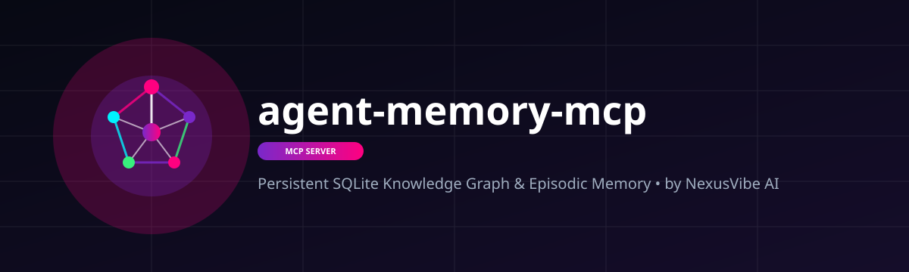
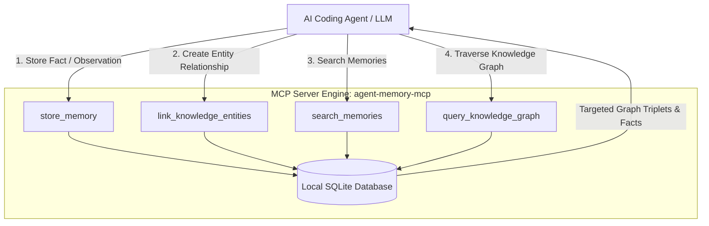

<<div align="center">
  
</div>

<p align="center">
  <b>🇬🇧 English • 🇮🇳 हिन्दी • 🇨🇳 中文 • 🇯🇵 日本語 • 🇪🇸 Español • 🇩🇪 Deutsch • 🇫🇷 Français • 🇰🇷 한국어</b>
</p>

<p align="center">
  <a href="#-quick-start">Quick Start</a> •
  <a href="#-how-it-works">How It Works</a> •
  <a href="#-3-layer-memory-workflow">3-Layer Workflow</a> •
  <a href="#-mcp-tools">MCP Tools</a> •
  <a href="#-architecture">Architecture</a> •
  <a href="#-security">Security</a> •
  <a href="#-license">License</a>
</p>

---

> **Persistent SQLite Knowledge Graph & Episodic Memory Engine for Autonomous AI Agents & LLMs.**

---

## 💡 Why This Exists & Token Efficiency

LLMs suffer from context window amnesia across chat sessions, re-asking user preferences and losing project history. **`agent-memory-mcp`** introduces a **claude-mem** style **3-layer workflow** with local SQLite persistent storage for infinite cross-session memory recall.

### ⚡ 3-Layer Memory Workflow
1. **Layer 1: Episodic Storage (`store_memory`)** – Persists key-value facts, user preferences, and observations with categories and ISO timestamps.
2. **Layer 2: Semantic Graph Linkage (`link_knowledge_entities`)** – Establishes semantic graph edges (`subject -> predicate -> object`) to build interconnected entity networks.
3. **Layer 3: Work Pattern Index (`index_pattern`)** – Indexes reusable agent workflows, coding patterns, and heuristics for instant recall.

---

## 🚀 Multi-IDE Quick Start

### 1. Claude Code CLI / Claude Desktop
```json
{
  "mcpServers": {
    "agent-memory": {
      "command": "python3",
      "args": ["/path/to/agent-memory-mcp/agent_memory_mcp.py"]
    }
  }
}
```

### 2. Cursor IDE
Add to `.cursor/mcp.json` or Cursor Settings -> MCP Servers:
- **Type**: `command`
- **Command**: `python3 /path/to/agent-memory-mcp/agent_memory_mcp.py`

### 3. Codex CLI / Antigravity / OpenCode / Windsurf
```bash
mcp add agent-memory -- python3 /path/to/agent-memory-mcp/agent_memory_mcp.py
```

---

## 🛠️ MCP Tools

| Tool | Parameters | Description |
| --- | --- | --- |
| `store_memory` | `key`, `value`, `category` | Store episodic memory key-value pairs |
| `retrieve_memory` | `key` | Retrieve stored episodic memory by key |
| `search_memories` | `query`, `category` | Search memories by query string or category |
| `link_knowledge_entities` | `subject`, `predicate`, `object` | Build knowledge graph relations |
| `query_knowledge_graph` | `entity` | Query connected relations in the knowledge graph |
| `index_pattern` | `pattern_name`, `heuristic` | Index reusable work patterns & strategies |

---

## 🛡️ Security & Privacy

- **Local-Only Storage**: Zero external network transmission. All data remains inside local `memory.db` SQLite database.
- **NexusVibe AI Security Standard**: Verified zero-telemetry disclosure.

---

## 📄 License

Distributed under the [MIT License](LICENSE). Copyright © 2026 **Jitendra Kumar** (NexusVibe AI Tech).--26-7928CA?style=for-the-badge" alt="MCP Spec" />
  
  
  
  
</p>

---

> **Persistent SQLite Knowledge Graph & Episodic Memory Engine for Autonomous AI Agents & LLMs.**

---

## 💡 Why This Exists & Token Efficiency

LLMs suffer from context window amnesia across chat sessions, re-asking user preferences and losing project history. **`agent-memory-mcp`** introduces a **`claude-mem` style 3-layer workflow** with local SQLite persistent storage for infinite cross-session memory recall.

### ⚡ 3-Layer Memory Workflow

1. **Layer 1: Episodic Storage (`store_memory`)** — Persists key-value facts, user preferences, and observations with categories and ISO timestamps.
2. **Layer 2: Semantic Graph Linkage (`link_knowledge_entities`)** — Establishes semantic graph edges (`subject` -> `predicate` -> `object`) to build interconnected entity networks.
3. **Layer 3: Infinite Recall (`search_memories` & `query_knowledge_graph`)** — Queries stored memories with fuzzy keyword matching and traverses knowledge graph triplets across sessions.

### 📊 Token Savings & Memory Recall Comparison

| Approach | Memory Persistence | Token Waste | Cross-Session Recall | Efficiency |
| :--- | :--- | :--- | :--- | :--- |
| **Naive Prompt Repetition** | None (Lost on reset) | Heavy (~30,000 tokens) | No | 0% |
| **Flat File Text Logs** | Manual file reads | High (~12,000 tokens) | Limited | ~50% |
| **`agent-memory-mcp` SQLite Engine** | **Permanent Local SQLite** | Minimal (~1,200 tokens) | **Infinite** 🚀 | **~90% Token Savings** |

---

## 🏗️ Architecture Diagram



---

## 🛠️ Tools Included

1. `store_memory`: Persists key-value facts and state observations into SQLite with categories and automatic ISO timestamps.
2. `search_memories`: Queries stored episodic memories using fuzzy keyword matching and category filters.
3. `link_knowledge_entities`: Creates semantic graph edges (`subject` -> `predicate` -> `object`) in SQLite to establish structured knowledge networks.
4. `query_knowledge_graph`: Traverses knowledge graph triplets to retrieve all connected concepts, entities, and context around a given target.

---

## 🚀 Quick Start (1-Click & 1-Command Setup)

### 1. Claude Code CLI
```bash
claude mcp add agent-memory-mcp -- python -m agent_memory_mcp
```

### 2. Cursor (`.cursor/mcp.json`)
```json
{
  "mcpServers": {
    "agent-memory-mcp": {
      "command": "python",
      "args": ["-m", "agent_memory_mcp"]
    }
  }
}
```

### 3. OpenAI Codex CLI (`~/.codex/config.toml`)
```toml
[mcp_servers.agent-memory-mcp]
command = "python"
args = ["-m", "agent_memory_mcp"]
```

### 4. Google Antigravity IDE (`mcp_config.json`)
```json
{
  "mcpServers": {
    "agent-memory-mcp": {
      "command": "python",
      "args": ["-m", "agent_memory_mcp"]
    }
  }
}
```

### 5. Windsurf / Cline
```json
{
  "mcpServers": {
    "agent-memory-mcp": {
      "command": "python",
      "args": ["-m", "agent_memory_mcp"]
    }
  }
}
```

---

<div align="center">
  <sub>Built with ❤️ by <b>Jitendra Kumar • NexusVibe AI</b></sub>
</div>
